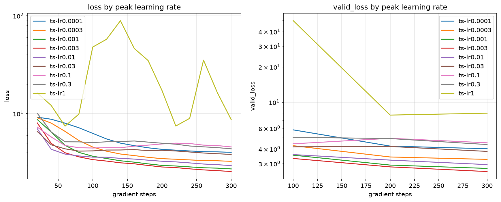

# Learning rate sweep

| run | peak lr | steps | peak loss | final loss | final valid_loss | best valid_loss | diverged |
|---|---:|---:|---:|---:|---:|---:|:---:|
| ts-lr0.0001 | 0.0001 | 300 | 9.20 | 4.0239 | 4.0200 | 4.0200 |  |
| ts-lr0.0003 | 0.0003 | 300 | 9.07 | 3.2556 | 3.2623 | 3.2623 |  |
| ts-lr0.001 | 0.001 | 300 | 8.70 | 2.7226 | 2.7320 | 2.7320 |  |
| ts-lr0.003 | 0.003 | 300 | 8.02 | 2.5597 | 2.5690 | 2.5690 |  |
| ts-lr0.01 | 0.01 | 300 | 6.99 | 2.9422 | 2.9445 | 2.9445 |  |
| ts-lr0.03 | 0.03 | 300 | 6.57 | 3.8270 | 3.8150 | 3.8150 |  |
| ts-lr0.1 | 0.1 | 300 | 7.27 | 4.5680 | 4.5178 | 4.4275 |  |
| ts-lr0.3 | 0.3 | 300 | 10.07 | 4.3692 | 4.3649 | 4.3649 |  |
| ts-lr1 | 1 | 300 | 89.07 | 8.6831 | 8.0755 | 7.7812 | yes |

Best run: ts-lr0.003 at peak learning rate 0.003, validation loss 2.5690.
Divergence first appears at 1; the largest stable rate is 0.3. The best rate is 333x below the first divergent one and 100x below the largest stable one.

